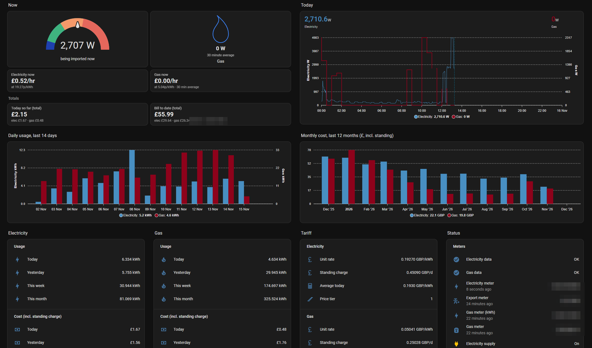

# Example dashboard

[`trio-dashboard.yaml`](trio-dashboard.yaml) is a Home Assistant dashboard for the tap's sensors. It has a Trio-style electricity dial and gas flame, cost tiles, today/daily/monthly charts and entity lists for electricity, gas, tariff and status.

## Requirements

- **Custom cards** (install from HA's Marketplace / HACS): [button-card](https://github.com/custom-cards/button-card) and [apexcharts-card](https://github.com/RomRider/apexcharts-card).
- **Entity IDs** assume the ESPHome device is called `geo-trio-tap` (entities `sensor.geo_trio_tap_...`). If yours is different, find and replace the prefix.
- **"Bill to date (total)"** uses a template helper that adds the two bill sensors. Create it in Settings → Devices & services → Helpers → Create helper → Template → Template sensor:
  - Name: `Geo Trio Tap Bill to date total` (gives `sensor.geo_trio_tap_bill_to_date_total`)
  - State: `{{ (states('sensor.geo_trio_tap_electricity_bill_to_date') | float(0) + states('sensor.geo_trio_tap_gas_bill_to_date') | float(0)) | round(2) }}`
  - Unit `GBP`, device class Monetary

## Install

Settings → Dashboards → Add dashboard → New dashboard from scratch, open it, then ⋮ → Edit dashboard → ⋮ → Raw configuration editor, and paste the file's contents.

## Notes

- The electricity dial's colour bands are set to match one Trio's display (green to 1.5 kW, orange to 3.1 kW, red above). The meter sends its own thresholds in Device Management attributes 0x0400/0x0401; change the `segments` to suit yours.
- The gas flame fills at `full_kw: 25`; change it to suit your boiler.
